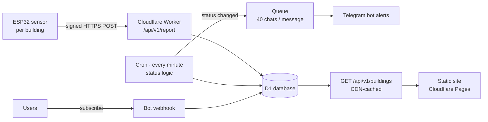

# YH_Electricity ⚡

Real-time electricity status for apartment buildings in Kyiv, with Telegram alerts within about a minute when power goes off or comes back.

> **Status:** Phase 0 (project setup). Pilot building: Revutskogo 54a.

## How it works

Each building has **one sensor**: an ESP32 board on its own 18650 battery, powered by an ordinary USB charger in a wall socket. The sensor reports whether that charger has power every 60 s, and **at once** when it changes. Because the board runs on its own battery, it can report "grid off" instead of just going silent. A dead Wi-Fi router therefore shows as *no data*, never as a false blackout.

- **Accurate:** a battery-backed sensor tells "power lost" apart from "internet lost".
- **Fast:** status pages are static and cached at the CDN, and alerts arrive within about 60 s.
- **Safe:** sensors only send signed outgoing messages, the public site is read-only, and admin sits behind Cloudflare Access.
- **Free to run:** everything fits Cloudflare's free plan (up to 10 buildings and a few thousand users).

## Repository layout

| Folder | What's inside |
|---|---|
| [`worker/`](worker/) | Cloudflare Worker: sensor API, cron status logic, queue fan-out, Telegram bot webhook |
| [`web/`](web/) | Static website (Cloudflare Pages, PWA) |
| [`firmware/`](firmware/) | ESP32 sensor firmware |
| [`docs/`](docs/) | Architecture, decision records, runbook |

## Links

- Website: `https://svitlo.yanasworks.com` *(coming in Phase 5)*
- Telegram bot: *(coming in Phase 4)*

## Roadmap

- [ ] **Phase 0:** setup (domain, accounts, repo)
- [ ] **Phase 1:** sensor prototype
- [ ] **Phase 2:** backend core (Workers, D1, cron)
- [ ] **Phase 3:** notification fan-out (Queues)
- [ ] **Phase 4:** Telegram bot
- [ ] **Phase 5:** website
- [ ] **Phase 6:** admin panel
- [ ] **Phase 7:** pilot at Revutskogo 54a
- [ ] **Phase 8:** more buildings
- [ ] **Phase 9:** portfolio polish

## Security

Secrets (bot token, master key, sensor keys, Wi-Fi passwords) never go in this repository. See [SECURITY.md](SECURITY.md).

## License

[MIT](LICENSE) © 2026 Yana Hlybovets
